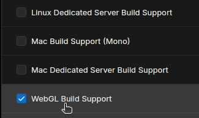
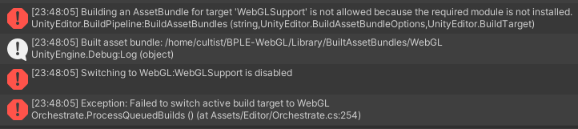

<h1 align=center><b>BPLE WebGL Port</b></h1>

    
> [!IMPORTANT]
> This project is made with a *very* major help of LLMs (GitHub Copilot), so code quality isn't to be expected here. Use this project at your own sanity or tolerance of it.  
## Build from source:  
1. Install [Unity Hub](https://docs.unity.com/en-us/hub/install-hub-win-mac)  
2. Install [Unity 2021.3.45f2](https://unity.com/releases/editor/whats-new/2021.3.45f2) (installing Editor in Unity Hub is recommended)  
3. install [Git](https://git-scm.com/install/) then open `Git Bash`  
4. Type `git clone https://github.com/Aibat309boy/BPLE-WebGL.git` in your Git Bash terminal and hit enter  
     
5. Add the project's root directory in Unity Hub via this button:  
     
6. BPLE > `Build` or `Bundle` > WebGL on the Editor toolbar  
     
7. Wait for compilation... then enjoy :)  
> [!NOTE]  
> You must make sure to install WebGL build modules for the Editor:  
>   
> Otherwise, this is bound to happen when you start the compilation...  
>   
## Credits to:  
- [Anstro Pleuton](https://github.com/anstropleuton) for decompilation of [BPLE](https://github.com/anstropleuton/BPLE)
